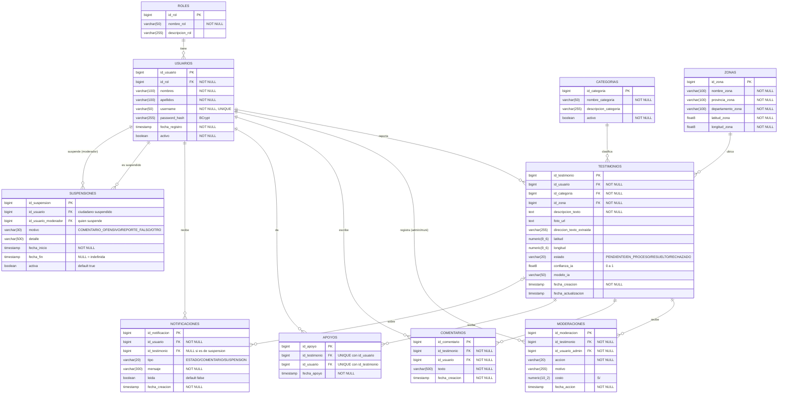

# ReclamaYA (Report And Be Heard): estado del proyecto

> Actualizado el **25/11/2026** (incluye el cambio de diseño a Bootstrap, Roboto y Material Icons), después de revisar el código de `report-and-be-hear-api/` y `report-and-be-heard-front/` en la rama `PRUEBA`.
> Proyecto final del curso **Arquitectura de Aplicaciones Web (UPC)**.
> El producto se llama **ReclamaYA**. "Report And Be Heard" es el nombre original y se mantiene en las carpetas y en el repositorio.

---

## 1. Qué es

Es una plataforma web donde la ciudadanía peruana reporta problemas de su ciudad (baches, basura, alumbrado, seguridad, agua y desagüe, etc.) y los ve sobre un **mapa del Perú** con departamentos, provincias y distritos. La **municipalidad** y el **administrador** atienden los reclamos desde un panel: cambian su estado, registran costos, moderan y suspenden cuentas. El alcance es **todo el Perú**.

- Código de referencia de cada reclamo: `RYA-0001`, `RYA-0002`, …
- **Misión:** dar voz a la ciudadanía frente a problemas desatendidos y convertir sus reportes en información clara y accionable para las autoridades.
- **Visión:** ser la plataforma de referencia en el Perú para la vigilancia ciudadana, conectando comunidades y municipalidades para que las respuestas sean más rápidas y justas.

### Segmentos objetivo
1. **Ciudadanos y vecinos afectados**, que son quienes reportan (de 18 a 65 años, en zonas urbanas y periurbanas).
2. **Municipalidades y autoridades locales**, que necesitan un mapa consolidado y priorizado.
3. **Líderes comunitarios y ONG**, que buscan evidencia con datos para exigir respuestas.
4. **Investigadores y analistas**, que necesitan un histórico georreferenciado.

---

## 2. Carpetas

```
Report And Be Heard/
├── ReportAndBeHeard-progreso.md      ← este archivo (contexto principal)
├── report-and-be-heard-contexto.md   ← contexto antiguo (oct.), desactualizado
├── diagrama.erd, rubrica proyecto.docx, Contents.docx
└── fullstack/
    ├── contexto.md                   ← contexto intermedio (nov.), parcialmente desactualizado
    ├── documentacion_proyecto.docx
    └── report-and-be-hear/           ← REPO GIT (rama PRUEBA)
        ├── README.md                 ← cómo correr el proyecto
        ├── report-and-be-hear-api/   ← BACKEND (lo más importante)
        ├── report-and-be-heard-front/← FRONTEND (lo más importante)
        ├── profesora/                ← ejemplos de la profesora (semana13, demoMO, demoFront8208, Seguridad_vi, graficos.txt). No se sube.
        └── reclamaya-icono.png
```

**Regla:** el código debe seguir el patrón de los ejemplos de la profesora (`profesora/`). Por ejemplo, los gráficos se hacen con componentes `reporteNNcomponent` y ng2-charts.

---

## 3. Repositorio y Git

- GitHub: `github.com/andresklve/report-and-be-hear` (antes se llamaba `report-and-be-hear-api`; GitHub redirige). En la PC el remoto usa SSH.
- **`main`**: tiene el backend en la raíz y llega hasta el PR #8 (CORS, security inhabilitado y `confianzaIA`/`modeloIA` en los DTOs).
- **`PRUEBA`** (rama de trabajo): tiene dos carpetas (api y front) y un README. **Todavía no hay PR a main**, porque es una decisión del usuario.
  - Últimos commits: `b11ded9` usuarios con username en lugar de correo · `37bf540` icono de ReclamaYA como logo · `8ac4cc6` PRUEBA lista para correr al clonar · `367f746` comentarios, apoyos, notificaciones y suspensiones, y front con Angular Material · `c5a9628` separación en dos carpetas.
  - **Cambios sin commit (25/11):** se rehicieron los gráficos al formato de la profesora. Se borraron `barrascomponent`, `columnascomponent` y `donacomponent`; se agregaron `components/reportecomponent/reporte01…07component` y `shared/graficos.ts`; se cambiaron `resultados*`, `resumen`, `login`, `registro`, `app.config.ts` (provideCharts) y `package.json` (chart.js y ng2-charts). También son nuevos `datos-prueba/mas_datos.sql` y `limpiar_datos.sql`.
  - Al mergear a main, en Render hay que poner Root Directory = `report-and-be-hear-api`.
- Preferencias del usuario: commits **sin coautor**, nada directo a `main` y no tocar el backend salvo que lo pida.

---

## 4. Equipo y reparto (Sprints 1 y 2)

| Integrante | Entidades (CRUD) | Reportes |
|---|---|---|
| **Carlos** | Rol (US01), Zona (US02), seguridad JWT | US07 Mapa de calor por zona, US08 Reclamos por categoría |
| **Edicson** | Categoria (US03), Usuario (US04) | US09 Tendencia temporal, US10 Ranking de zonas |
| **Ernesto** | Testimonio | US11 Inversión por departamento, US12 Costo por categoría |
| **Gianfranco** | Moderacion (US06) | US13 Tiempo de atención, US14 Desempeño de la IA |

Regla al integrar ramas: si hay conflicto, **gana la versión del dueño real** de la entidad.

---

## 5. Stack tecnológico

| Capa | Tecnología |
|---|---|
| Backend | **Java 21**, **Spring Boot 4.1.1**, **Google Gemini** (API REST, IA), Spring Data JPA (Hibernate), Spring Security + OAuth2 Resource Server (JWT **HS512**), BCrypt, **ModelMapper 3.2.6**, **springdoc-openapi 3.1.0** (Swagger), Maven Wrapper, devtools |
| Base de datos | **PostgreSQL 18** (local en `/Library/PostgreSQL/18`, servicio `postgresql-18`), base `BDReportAndBeHeard`; Hibernate crea las tablas (`ddl-auto=update`) |
| Frontend | **Angular 21.2** (standalone, signals, SSR con Express 5), **Angular Material 21** (Material 3), **Bootstrap 5.3** (CDN), **Roboto** y **Material Icons** (Google Fonts), **Leaflet 1.9.4**, **Chart.js 4 + ng2-charts 10**, RxJS 7.8, TypeScript 5.9, Vitest |
| Despliegue | Docker en dos etapas (`eclipse-temurin:21-jdk` → `21-jre`), Render (API) y Neon (PostgreSQL) |
| Puertos | API **8084** · Front **4200** (dev) · SSR 4000 · PostgreSQL 5432 |

---

## 6. Base de datos

PostgreSQL normalizada a 3FN, con **10 tablas**: las 6 originales (`roles`, `usuarios`, `zonas`, `categorias`, `testimonios`, `moderaciones`) y 4 nuevas (`comentarios`, `apoyos`, `notificaciones`, `suspensiones`).
Hibernate convierte los nombres camelCase a snake_case (por ejemplo, `nombreRol` queda como `nombre_rol`).

### Diagrama entidad-relación



### Notas de la base
- `zonas.departamento_zona` existe a propósito para los reportes por departamento y para cubrir todo el Perú.
- `apoyos` tiene una restricción **UNIQUE (id_testimonio, id_usuario)**: un ciudadano solo puede apoyar una vez cada reclamo.
- `usuarios` usaba antes `correo`; ahora usa **`username`**. El archivo `src/main/resources/schema.sql` migra las bases antiguas (renombra la columna y deja la parte del correo antes de la @) y se ejecuta antes de Hibernate.
- Estados de un testimonio: `PENDIENTE` (se muestra como "Recibido"), `EN_PROCESO` ("En atención"), `RESUELTO` y `RECHAZADO` ("Descartado").

---

## 7. Backend (`report-and-be-hear-api/`)

Paquete `pe.edu.upc.reportandbeheard`, con la estructura del curso (demoMO):
`configs/` (CorsConfig, ModelMapperConfig, OpenApiConfig) · `controllers/` (12) · `dtos/` (27) · `entities/` (10) · `exceptions/` (GlobalExceptionHandler, ResourceNotFoundException, OperacionNoPermitidaException, ErrorResponse) · `repositories/` (10, con `I…Repository`) · `securities/` (SecurityConfig, JwtConfig, JwtTokenService, CustomJwtAuthenticationConverter) · `servicesinterfaces/` + `servicesimplements/`.

### Configuración
- `application.properties` importa `optional:file:./local.properties`, que es propio de cada PC y no se sube (hay un `local.properties.example`).
- Las variables de entorno `DB_URL`, `DB_USER`, `DB_PASSWORD` y `JWT_SECRET` tienen valores por defecto, así que el proyecto corre al clonar (`localhost:5432`, `postgres/postgres` y un secreto de desarrollo de 96 caracteres, que es suficiente para HS512).
- `spring.sql.init.mode=always` hace que se ejecute `schema.sql`.
- **Security desactivado a propósito** (decisión del equipo): `@EnableMethodSecurity` está comentado y todo es `permitAll`, así que los `@PreAuthorize` no se aplican. El acceso del front se controla con **CORS**. `/login` sí emite el JWT y el front lo envía igual (con un interceptor).
- **CORS**: solo `http://localhost:4200`, con los métodos GET, POST, PUT, DELETE, PATCH y OPTIONS.
- Swagger: `http://localhost:8084/swagger-ui/index.html` (título "Report And Be Heard API" v1.0.0).

### Reglas de negocio
- El **registro público** (`POST /apis/usuarios`) siempre crea al usuario como CIUDADANO; el servidor pone el rol, el estado y la fecha. La contraseña se guarda con BCrypt. El PUT exige `passwordHash`.
- **Suspensiones:** solo se suspende a ciudadanos, con motivo `COMENTARIO_OFENSIVO`, `REPORTE_FALSO` u `OTRO` y por un número de días opcional (si no se indica, la suspensión es indefinida). Mientras dura, el usuario no puede **ingresar, reportar, comentar ni apoyar** (`validarNoSuspendido`). Solo puede haber una suspensión vigente por usuario y se puede levantar.
- **Notificaciones automáticas:**
  - Una moderación avisa al autor del reclamo (tipo `ESTADO`), por ejemplo: "La municipalidad está atendiendo tu reporte RYA-0012."
  - Un comentario avisa al autor si quien comenta es otra persona (`COMENTARIO`).
  - Suspender o levantar una suspensión avisa al usuario (`SUSPENSION`).
- Moderación: `accion` (EN_PROCESO, RESUELTO, RECHAZADO) más `costo` en soles, que alimenta los reportes de inversión.

### Endpoints de la API propia (`http://localhost:8084`)

La columna de rol muestra el `@PreAuthorize` declarado en el código. Como security está desactivado, no se aplica.

| Recurso | Método y ruta | Rol |
|---|---|---|
| **Login** | `POST /login` → `{token, username}` | público |
| **Roles** | `GET /apis/roles` · `GET /{id}` · `POST` · `PUT` · `DELETE /{id}` | ADMIN |
| **Usuarios** | `POST /apis/usuarios` (registro) | público |
| | `GET` · `GET /{id}` · `PUT` · `DELETE /{id}` | ADMIN |
| **Zonas** | `GET /apis/zonas` · `GET /{id}` | todos |
| | `POST` · `PUT` · `DELETE /{id}` | ADMIN |
| **Categorías** | `GET /apis/categorias` · `GET /{id}` | todos |
| | `POST` · `PUT` · `DELETE /{id}` | ADMIN |
| **Testimonios** | `GET /apis/testimonios` · `GET /{id}` | todos |
| | `POST` | CIUDADANO, ADMIN |
| | `PUT /{id}` · `DELETE /{id}` | ADMIN |
| **Moderaciones** | `GET /apis/moderaciones` · `GET /{id}` · `POST` · `PUT` · `DELETE /{id}` | ADMIN, MUNI |
| **Comentarios** | `GET /apis/comentarios?idTestimonio=` · `POST` · `DELETE /{id}` | todos |
| **Apoyos** | `GET /apis/apoyos/testimonio/{id}` (resumen) · `GET /ranking` | todos |
| | `POST` · `DELETE /testimonio/{idT}/usuario/{idU}` | CIUDADANO |
| **Notificaciones** | `GET /apis/notificaciones/usuario/{id}` · `PUT /{id}/leida` · `PUT /usuario/{id}/leidas` | todos |
| **Suspensiones** | `GET /apis/suspensiones` · `POST` · `PUT /{id}/levantar` | ADMIN, MUNI |
| **IA** | `POST /apis/ia/clasificar` `{texto}` → `{idCategoria, nombreCategoria, direccionTextoExtraida, confianzaIA, modeloIA}` (US37/US38) | CIUDADANO, ADMIN |
| | `GET /usuario/{id}/vigente` | todos |
| **Reportes** | `GET /apis/reportes/mapa-calor` (US07) · `/por-categoria` (US08) | todos |
| | `/tendencia?agrupacion=dia\|mes` (US09) · `/ranking-zonas` (US10) · `/inversion-por-departamento` (US11) · `/costo-por-categoria` (US12) · `/tiempo-atencion` (US13) | ADMIN, MUNI |
| | `/desempeno-ia` (US14) | ADMIN |

Consultas de los reportes: JPQL con `SELECT new …DTO(...)` (mapa de calor, por categoría con LEFT JOIN `testimonios`–`categorias`, ranking, inversión, costo y desempeño de la IA) y SQL nativo (tendencia con `to_char` y tiempo de atención con `EXTRACT(EPOCH …)`).

### Ejecutar
```bash
# 1. PostgreSQL tiene que estar encendido (si no lo está):
sudo launchctl kickstart system/postgresql-18
# 2. Backend
cd report-and-be-hear-api
./mvnw spring-boot:run            # Windows: mvnw.cmd spring-boot:run
```

---

## 8. Frontend (`report-and-be-heard-front/`)

Angular 21 standalone con signals, SSR (rutas en modo Client), Angular Material (M3) y locale `es-PE`. La estructura sigue a la profesora: `models/` (DTOs), `services/` (uno por entidad, más `reporteservice`, `resultadosservice`, `authservice`, `geoservice`, `datosservice` y `toastservice`), `components/<x>component/` con `<x>listcomponent` y `<x>insertcomponent` (rutas `listar`, `insertar` y `ediciones/:id`), y `shared/` (guards, authinterceptor, paginador en español, ui, graficos).

- `environment.base = 'http://localhost:8084'`, tanto en dev como en prod. **El front todavía no apunta a Render.**
- Sesión: guards `sesionGuard`, `equipoGuard` (municipalidad o admin) y `adminGuard`, más un interceptor que envía `Authorization: Bearer <jwt>`.

### Pantallas (rutas)
| Ruta | Qué hace |
|---|---|
| `/` | Inicio: "Reclamos ciudadanos del Perú, en un solo mapa", información y preguntas frecuentes |
| `/mapa` | **Mapa del Perú** con Leaflet, sin mapa base. Muestra departamentos, luego provincias y luego distritos según el zoom, con colores de semáforo según la cantidad de quejas. Tiene buscador, panel con resumen y ranking, y últimos reclamos. Lo que queda fuera de la selección se pinta de blanco |
| `/reportar` | Wizard de 3 pasos (**Problema → Lugar → Enviar**). (1) Primero se **escribe** el reclamo; la tarjeta **Sugerir con IA** (también se activa sola al salir del campo) elige el tipo de problema, que queda marcado con check y la etiqueta "Sugerido", y extrae la dirección. (2) Mapa OSM: si la IA encontró un distrito en la dirección, aparece **"¿Es en Lince?"**, que lleva el mapa a ese distrito y coloca el marcador. También se puede buscar o tocar el punto; si la zona no existe, se crea. (3) Revisión y envío, con registro o ingreso dentro del mismo paso. Guarda un borrador en sessionStorage. Si el texto no menciona dirección, no pasa nada: la ubicación oficial es el punto del mapa |
| `/reporte/:id` | Detalle público con estado (track), historial, mapa, **apoyos** ("Yo también", sin poder apoyar tu propio reclamo) y **comentarios** |
| `/cifras/...` | **Cifras** públicas (antes se llamaba "Resultados"; `/resultados` redirige aquí): tipos de problema, avance de atención, inversión, casos resueltos y más apoyados. Los componentes conservan el nombre `resultados*` |
| `/ingresar`, `/registro` | Pantalla dividida con el mapa del Perú (`img/mapa-departamentos.svg`). En tablet y celular (≤ 980 px) el mapa pasa a una franja oscura arriba del formulario. Se ingresa con **username** |
| `/mis-reportes` | Reclamos del ciudadano (requiere sesión) |
| `/panel/resumen` | Dashboard con los gráficos `reporte01…07` y una tabla de desempeño de la IA |
| `/panel/bandeja` | Bandeja de reclamos: "Atender" crea una moderación y cambia el estado; se puede suspender al autor |
| `/panel/moderaciones`, `/panel/suspensiones` | Listados (las suspensiones se pueden levantar) |
| `/panel/zonas`, `/panel/categorias` | CRUD completo (listar, insertar y editar) |
| `/panel/usuarios`, `/panel/roles` | CRUD, **solo para el administrador** |
| Menú | Campana de **notificaciones** con contador de no leídas |
| Celular (≤ 760 px) | Barra inferior con **solo 3 accesos**: Mapa · Reportar (+) · Cuenta/Ingresar. Inicio se abre con el logo y Cifras con un ícono en la barra superior |

### Gráficos (ng2-charts / Chart.js, patrón de la profesora)
| Componente | Reporte | Tipo |
|---|---|---|
| `reporte01component` | Reclamos por categoría (US08) | doughnut |
| `reporte02component` | Tendencia por día o mes (US09) | line |
| `reporte03component` | Costo por categoría (US12) | pie |
| `reporte04component` | Inversión por departamento (US11) | bar horizontal |
| `reporte05component` | Ranking de zonas (US10) | bar (panel → "Zonas más activas") |
| `reporte06component` | Reclamos por estado | doughnut |
| `reporte07component` | Costo promedio por reclamo y categoría | bar |
| `resultados*` (sección pública Cifras) | Tipos, avance (doughnut + bar) e inversión | bar / doughnut |

`shared/graficos.ts` traduce las variables CSS a colores reales, porque Chart.js dibuja en un canvas y no entiende `var(--x)`.

### Ejecutar
```bash
cd report-and-be-heard-front
npm install && npm start          # http://localhost:4200
```

---

## 9. Tipografía y diseño

Diseño **sobrio e institucional**. Hay un resumen visual en `infoaparte.pdf` (raíz del repo). El usuario **rechazó** el estilo "IA/marketing" (héroes enormes, cifras infladas, secciones de "cómo funciona").

### Librerías de diseño (las mismas que usa la profesora)
La app usa **solo** lo mismo que los ejemplos del curso (`profesora/`): **Angular Material, Bootstrap, Roboto, Material Icons y Chart.js + ng2-charts**. Leaflet se mantiene porque es el que dibuja los mapas; es funcionalidad, no diseño.

| Uso | Librería | Dónde se define |
|---|---|---|
| Componentes (botones, tablas, formularios, menús) | **Angular Material 21** (Material 3) | `material-theme.scss` |
| Estilos base del navegador | **Bootstrap 5.3.3** por CDN | `src/index.html`, cargado **antes** que `styles.css` para que los estilos propios ganen |
| Tipografía de toda la app y de los gráficos | **Roboto** (variable, pesos 400 a 800 y cursiva 400) | `--f` en `styles.css`, `plain-family`/`brand-family` en el tema y `Chart.defaults.font.family` en `shared/graficos.ts` |
| Códigos `RYA-0001` | **Roboto** con números de ancho fijo (`tabular-nums`) y sin salto de línea | `.mono` / `--f-mono` |
| Íconos | **Material Icons** (set clásico, relleno) | `index.html`; es la fuente por defecto de `<mat-icon>` |
| Gráficos | **Chart.js + ng2-charts** | componentes `reporteNN` |

- Body: 15 px y line-height 1.5. Títulos h1 a h4 en 700, con letter-spacing −0.01em.
- Pesos en Material: bold 700, medium 600 y regular 400. Los botones usan 600.
- Bordes redondeados: 4, 6 y 8 px (botones de 6 px y tarjetas de 8 px).
- **Cambios por Bootstrap:** se renombraron dos clases que Bootstrap también define: `.nav` pasó a `.barra` (barra superior) y `.lead` pasó a `.bajada` (subtítulo de las páginas).
- **Cambios de íconos al pasar de Material Symbols a Material Icons:** `monitoring` pasó a `analytics` (panel) y `shield_person` pasó a `local_police` (categoría Seguridad). Todos los íconos se verificaron contra la lista oficial de Material Icons.
- Ya **no** se usan Public Sans, JetBrains Mono ni Material Symbols Rounded.

### Paleta (`styles.css` y `material-theme.scss`)
| Token | Color | Uso |
|---|---|---|
| `--signal` / primary | **#C8102E** (rojo Perú) | Solo acciones |
| `--ink` / `--ink-2` / `--ink-3` | #16191D / #41474F / #6B727C | Texto |
| `--bg` / `--surface` / `--surface-2` | #F3F4F6 / #FFFFFF / #F8F9FA | Fondos |
| `--line` / `--line-2` | #E1E4E8 / #C9CED5 | Bordes |
| `--focus` | #1E5EFF | Foco |
| Estados | Recibido #E8A317 · En atención #2F7BD6 · Resuelto #3A9A48 · Descartado #9AA1AB | Chips y gráficos |
| Categorías (Okabe-Ito, aptas para daltónicos) | baches #0072B2 · basura #009E73 · seguridad #CC79A7 · alumbrado #E69F00 · agua #56B4E9 · otros #7A8089 | Gráficos |
| Semáforo del mapa | sin datos #E9ECEF · bajo #3FA34D · medio #F2A007 · alto #D62828 | Mapa |
| Series | tendencia #2F7BD6 · ranking #41474F · dinero #00876C | Reportes |

Tema de **Angular Material 3**: paleta primaria roja, terciaria azul y modo claro. Los campos usan `appearance: 'outline'`.

---

## 10. APIs y servicios usados

### APIs propias
- **ReclamaYA API REST** (Spring Boot, puerto 8084): todos los endpoints de la sección 7. Es la única API con la que el front intercambia datos.

### APIs y servicios externos
| Servicio | Para qué | Dónde |
|---|---|---|
| **OpenStreetMap Tiles** (`tile.openstreetmap.org/{z}/{x}/{y}.png`) | Mapa base del selector de ubicación en `/reportar` | `mapapickercomponent.ts` |
| **INEI – GeoIDEP WFS** (`geoespacial.inei.gob.pe/Interoperabilidad/ig_{departamento,provincia,distrito}/wfs`) | Límites oficiales de departamentos, provincias y distritos. **Se descargaron una sola vez** y se simplificaron en `public/geo/` (25 departamentos, 196 provincias, 1890 distritos e `indice.json` para el buscador). No se consulta en vivo | `geoservice.ts` lee los JSON locales |
| **Google Fonts** | Roboto y Material Icons | `index.html` |
| **jsDelivr (CDN)** | Entrega Bootstrap 5.3.3 | `index.html` |
| **Render** | Hosting de la API (Docker, plan Free). URL anterior: `https://report-and-be-heard-api.onrender.com` (en el plan Free se "duerme" sin uso) | `Dockerfile` |
| **Neon** | PostgreSQL en la nube (AWS US East 2) | despliegue |

- **Geocodificación:** se decidió **no usar Nominatim ni Google Maps**. El reclamo se ubica por sus coordenadas, buscando en qué polígono INEI cae el punto (punto dentro del polígono).
- **IA: Google Gemini (API REST de Google AI Studio, plan gratuito).** El backend llama a `POST https://generativelanguage.googleapis.com/v1beta/models/{modelo}:generateContent` con la cabecera `x-goog-api-key` y salida JSON estructurada (`responseSchema`). **Lista de modelos en orden** (`gemini.models` / `GEMINI_MODELS`): `gemini-3.5-flash-lite, gemini-flash-lite-latest, gemini-3.8-flash`. Si uno responde 503 (saturado) o tarda más de 10 s, se prueba el siguiente, y `modeloIA` guarda el que respondió. `gemini-2.5-flash` ya no está disponible para cuentas nuevas (404). Las claves nuevas de Google empiezan con `AQ.`, no con `AIza`.
  - Clase: `servicesimplements/IAServiceImplement.java`; endpoint en `controllers/IAController.java`.
  - Clave: `gemini.api.key` en `local.properties` (no se sube) o la variable `GEMINI_API_KEY`. Se creó en AI Studio la clave **"ReclamaYA"** (proyecto "Default Gemini Project") en la cuenta del usuario.
  - **Respaldo:** sin clave o si Gemini falla, clasifica con reglas por palabras clave y extrae la dirección con una expresión regular; `modeloIA = "reglas"`.
  - Front: en `/reportar`, paso 1, tarjeta "Clasificación con IA" con botón **Sugerir con IA**. También se activa sola al salir del campo de descripción si no hay categoría elegida. Elige la categoría y llena la dirección. `confianzaIA` y `modeloIA` se guardan en el testimonio solo si el ciudadano se queda con la categoría sugerida, y alimentan el reporte US14.
  - Ojo: en el plan gratis de Gemini, Google puede usar los textos para mejorar sus productos.

### Librerías clave (no son APIs)
Leaflet (mapas), Chart.js con ng2-charts (gráficos), Angular Material/CDK y Bootstrap (UI), ModelMapper (DTOs), springdoc (Swagger) y BCrypt (contraseñas).

---

## 11. Datos de prueba (`report-and-be-heard-front/datos-prueba/`)

| Archivo | Qué hace |
|---|---|
| `inyectar_datos.py` | Usa la API para crear roles, zonas y categorías base, 3 ciudadanos y las cuentas `municipalidad` y `admin` |
| `inyectar_peru.py` | Usa la API para crear unas 390 zonas en las 196 provincias, 12 ciudadanos, unos 2400 reclamos y unas 1300 moderaciones |
| `mas_datos.sql` | Va directo a PostgreSQL y crea 12 meses de historia para que la tendencia tenga sentido (la API siempre pone la fecha de hoy) |
| `limpiar_datos.sql` | Une las categorías repetidas en mayúsculas (BASURA, AGUA_CONTAMINADA, …) y limpia datos sucios |

Cuentas demo (por username): `ana.torres` (ciudadana), `municipalidad` y `admin`. La contraseña está en `inyectar_datos.py`.

---

## 12. Estado

- ✅ Backend: 10 entidades, CRUD, 8 reportes (US07–US14), comentarios, apoyos, notificaciones y suspensiones, login JWT y Swagger.
- ✅ Frontend: mapa del Perú, wizard para reportar, detalle con apoyos y comentarios, cifras públicas, panel con CRUD, bandeja, moderaciones, suspensiones y notificaciones.
- ✅ Gráficos migrados a ng2-charts con el patrón de la profesora (**falta hacer el commit**).
- ✅ Login con username en lugar de correo, con migración automática.

## 13. Pendientes

1. **Hacer commit de los cambios de gráficos** en PRUEBA (por ahora están solo en local).
2. **IA (US37/US38):** ✅ funcionando con Gemini real (probado el 25/11: Baches 99%, Agua y desagüe 98%, Alumbrado 99%; reclamos sin categoría clara salen con ~40%). La clave ya está en `local.properties`. Si se publica en Render, poner `GEMINI_API_KEY` como variable de entorno y limitar el uso del endpoint (security está desactivado).
3. **Despliegue del front** y `environment.ts` de producción apuntando a Render; agregar el dominio del front al CORS.
4. Merge de PRUEBA a main (cuando el usuario lo decida; antes hay que integrar las ramas de los compañeros) y configurar Root Directory en Render.
5. Revisar visualmente la vista de celular.

## 14. Gestión y exposición
- **Trello:** Product Backlog con 32 HU (24 CRUD y 8 reportes) y Story Points Fibonacci. Sprint 1 con 24 tarjetas (formato "Como… quiero… para…" y escenarios Gherkin). Sprint 2 con 8 reportes (US07–US14). Sprint 3 corresponde al frontend.
- **Exposición** (Canva/PPT): problema, solución, Trello, GitHub, deploy y conclusiones.
